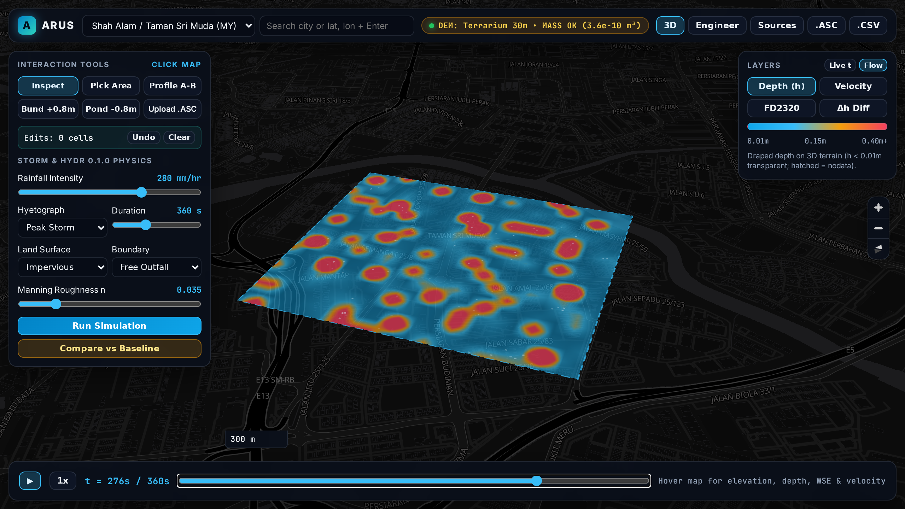
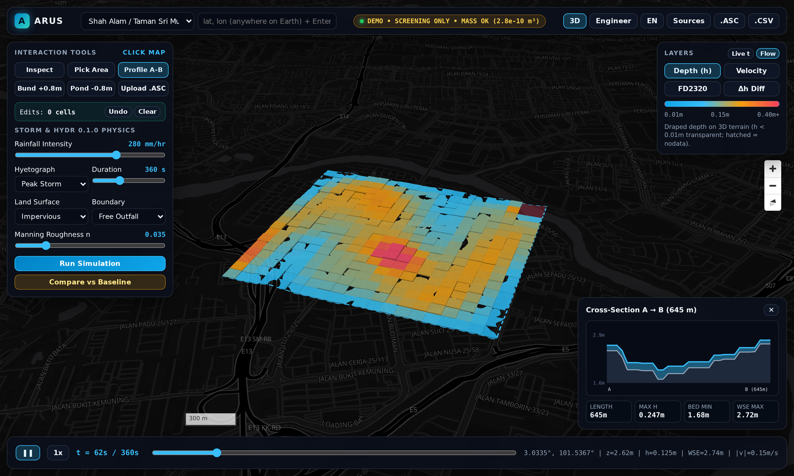
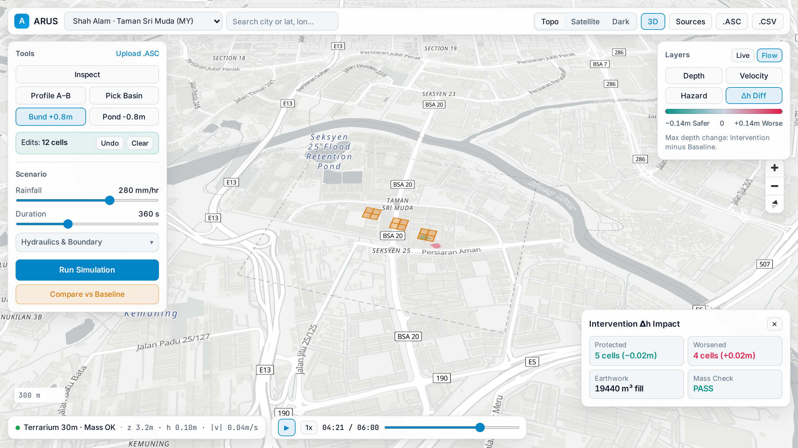

# ARUS

ARUS is a Rust 3D flood simulation and forecasting platform for hydrologists, drainage engineers, and forecast operators.



## Capabilities

- **2D Shallow-Water Solver (`hydr 0.3.0`)**: Runs `F64` and `F32` MUSCL solvers with Priority-Flood DEM conditioning. Preserves depressions deeper than `0.6 m` and carves D8 sub-grid river channels.
- **Spatial NWP Forcing**: Interpolates `nx × ny` rain grids, hourly FAO-56 Penman-Monteith `et0_mm` (suppressed above `0.2 mm/hr` rain), and initial `soil_moisture_init`. Applies per-cell Manning roughness (`0.032` channels, `0.060` floodplain, `0.110` upland) and `hourly_tide_m` backwater.
- **Pre-State Assimilation**: Seeds valley channels from `antecedent_rain_mm` and assimilates live river-gauge depths via `observed_gauges`.
- **4-Stage Forecast Pipeline (`arus-worker pipeline`)**: Computes soil and gauge headroom, 72–120h 1D hydrology ensembles, and coastal tide-lock checks. Triggers windowed 2D onset, peak, and recession runs.
- **3D Web Studio (`arus-api`)**: Renders Terrarium 30m DEMs, `Topo | Satellite | Dark` basemaps, emerald river channels, and OSM polygon-masked boundaries. Includes a `6 cm` runoff cutoff, DEFRA FD2320 hazard (`HR = h × (v + 0.5)`), `A → B` profiles, and Baseline vs Intervention `Δh` diffs.
- **Broadcast Overlays**: Displays an aligned `288px` left stack with live per-frame hotspot water levels and hourly tide status. Shows an `Area Flood Index` (`Avg Depth`, `Peak Depth`, `Flooded Area`, `Stagnant km²`).
- **Pure-Rust Video Export (`vidr 0.1.1`)**: Records JSON storyboards to H.264 faststart `.mp4` via `arus-worker record` over Chromium CDP (zero Python). Transcodes browser captures via `POST /api/v1/export/mp4`.
- **High-Resolution Async Jobs (`/api/v1/jobs`)**: Queues background basin runs up to `262,144` cells (`512×512`) and `12h` duration with live step progress and cooperative cancellation.
- **Automated Hindcast Calibration (`arus-worker calibrate`)**: Tunes Manning `n` and Green-Ampt conductivity against observed gauge hydrographs (`KGE`, `NSE`, `RMSE`, peak timing) and flood masks (`CSI`, `F1`), rejecting `LockedTest` leakage.
- **Scientific Provenance**: Displays terrain source (`Terrarium 30m`, uploaded `.asc`, or synthetic) and live mass-conservation residual (`PASS / FAIL`). Reports model-agreement spread and explicit `nodata` bounds.

## Screenshots

### Cross-Section Profile (`z` vs `z + h`)

Draw an `A → B` line across any flooded corridor to inspect bed elevation, water surface elevation, and cursor telemetry.



### Baseline vs Intervention `Δh` Diff

Paint floodwalls (`+0.8 m`) or detention ponds (`-0.8 m`) on the map to compare peak flood depth and earthwork cut/fill volumes (`m³`).



## Quick Start

Requires Rust `1.98.0` (pinned in `rust-toolchain.toml`).

```sh
cargo run --release -p arus-api -- --archive data/runs --bind 127.0.0.1:8080
```

For public hosted deployments, pass a server config file (`config/arus.hosted.example.json`) to toggle endpoints (`--config`):

```sh
cargo run --release -p arus-api -- --archive data/runs --config config/arus.hosted.example.json --bind 0.0.0.0:8080
```

Open `http://127.0.0.1:8080/` in a browser. Studio persists per-user display preferences in browser `localStorage` (`arus.studio.prefs.v1`) while URL query parameters override both browser and server defaults.

To enable client-side Browser WebGPU / WASM CPU offload (`hydr 0.3.0` + `numr 0.17.0` in a Web Worker, with automatic fallback to `Server · F64` when absent):

```sh
rustup target add wasm32-unknown-unknown
cargo build --manifest-path crates/wasm-solver/Cargo.toml --target wasm32-unknown-unknown --release
wasm-bindgen --target web --no-typescript --out-dir apps/web/assets/wasm crates/wasm-solver/target/wasm32-unknown-unknown/release/arus_wasm_solver.wasm
```

## Data Sources & Inputs

| Input | Source or Format | Parameters / Fields | Used By |
| --- | --- | --- | --- |
| Multi-model NWP rainfall & ET0 | Open-Meteo (`ecmwf_ifs025`, `gfs_global`, `icon_seamless`, `gem_global`, `jma_seamless`) | `precipitation`, `et0_fao_evapotranspiration`, `soil_moisture_0_to_7cm` | `arus-cli data sync`, `spatial_rain_grid` |
| Coastal tide & waves | Open-Meteo Marine (`openmeteo-marine-forecast`) | `sea_level_height_msl`, `wave_height` | Stage 3 tide-lock, `hourly_tide_m` |
| River discharge benchmark | GloFAS (`openmeteo-glofas-flood`) | `river_discharge`, `river_discharge_median`, `river_discharge_max` | `arus-cli data sync` |
| Official weather warnings | METMalaysia (`met-weather-warning`) | `product=warning` | `arus-cli data sync` |
| Bare-earth terrain | Terrarium 30m tiles or projected ESRI ASCII `.asc` | `terrain_elevations_m`, `ascii_dem` | `POST /api/v1/simulations` |
| River gauges & thresholds | Generic JSON (`arus-stations-v1`) | `normal_m`, `alert_m`, `warning_m`, `danger_m`, `observed_gauges` | `arus-worker pipeline`, `t = 0` seed |
| District / basin mask | OSM Nominatim polygon query | `loadBoundaryByQuery` | Studio canvas mask |

## Recipes

See [Forecast & Storyboard Operator Recipe](docs/forecast-and-storyboard-recipe.md) for JSON templates, station registry schemas, and URL query parameters.

### 1. Sync weather, marine, and warning feeds

```sh
cargo run --release -p arus-cli -- catalog check
cargo run --release -p arus-cli -- data sync --accept-noncommercial
```

ARUS stores raw payloads under `data/acquisition/blobs/` with SHA-256 receipts in `data/acquisition/receipts/`.

### 2. Run the 4-stage forecast pipeline

```sh
cargo run --release -p arus-worker -- pipeline \
  --meteo data/acquisition/blobs/<meteo-blob-sha256> \
  --marine data/acquisition/blobs/<marine-blob-sha256> \
  --stations stations.json \
  --station-id 5527401 \
  --current-stage-m 6.41 \
  --basin-id sg-setiu \
  --area-km2 876.89 \
  --impervious-fraction 0.10 \
  --past-hours 48 \
  --window-hours 6
```

### 3. Record a storyboard `.mp4` (Pure Rust)

Build `arus-api` and `arus-worker`, then run `arus-worker record`:

```sh
cargo build --release -p arus-api -p arus-worker

./target/release/arus-worker record \
  --spec docs/storyboard-example.json \
  --out /tmp/arus-storyboard-out \
  --resolution 720p \
  --fps 15
```

`arus-worker record` spawns `arus-api` automatically when `--url` is omitted. It drives `window.arusDirector` over Chromium CDP and writes `<name>.mp4`, numbered `.png` screenshots, and `summary.json`.

Transcode any standalone `.webm` capture with optional leading-frame trim:

```sh
cargo run --release -p arus-worker -- transcode \
  --input arus-recording.webm \
  --output arus-recording.mp4 \
  --trim-start-s 0.0
```

## Best Practices

- **Spatial NWP Grid**: Sample at least a `3×4` grid across upland headwaters and coastal plains. Single-point rainfall misses orographic rain gradients.
- **Dynamic Evaporation & Soil**: Pass hourly `et0_mm` and initial `soil_moisture_init` inside `spatial_rain_grid`. Constant daily loss rates distort monsoon recession.
- **Wet Antecedent State**: Combine `antecedent_rain_mm` with live `observed_gauges`. Dry-start runs underestimate river arrival times and floodplain storage.
- **Smooth Coastal Tide-Lock**: Provide `hourly_tide_m` from `sea_level_height_msl`. Smooth coastal drainage suppression avoids sudden boundary shocks.
- **Fixed-View Broadcasts**: Set `presentation=1` and `fixed=1` in storyboard `init` config. This locks camera framing and hides authoring chrome.
- **Commercial Licensing**: Open-Meteo free tier allows noncommercial prototyping only. Use a paid Open-Meteo plan or commercial-safe feeds (`ecmwf-open-data`, `noaa-gefs-aws`, `dwd-icon-open-data`) in production.
- **Calibration Gate**: Uncalibrated Terrarium runs carry a `DEMO • SCREENING ONLY` badge. Operational forecasts require surveyed bare-earth LiDAR, drainage geometry, and locked-event evaluation.

## Verification

Run local Rust tests with `cargo-nextest`:

```sh
cargo nextest run --workspace
cargo test --doc --workspace
```

Run the full offline repository check (formatting, compilation, tests, and `clippy -D warnings`):

```sh
sh scripts/check.sh --offline
```

## Documentation

- [Forecast & Storyboard Operator Recipe](docs/forecast-and-storyboard-recipe.md)
- [Data Acquisition Guide](docs/data-acquisition.md)
- [Architecture & Workspace Boundaries](docs/architecture.md)
- [Public HTTP API (`arus-api-v1`)](docs/api/README.md)
- [Analytical & Coupled Benchmarks](benchmarks/manifests/README.md)
- [Example Storyboard Spec](docs/storyboard-example.json)
