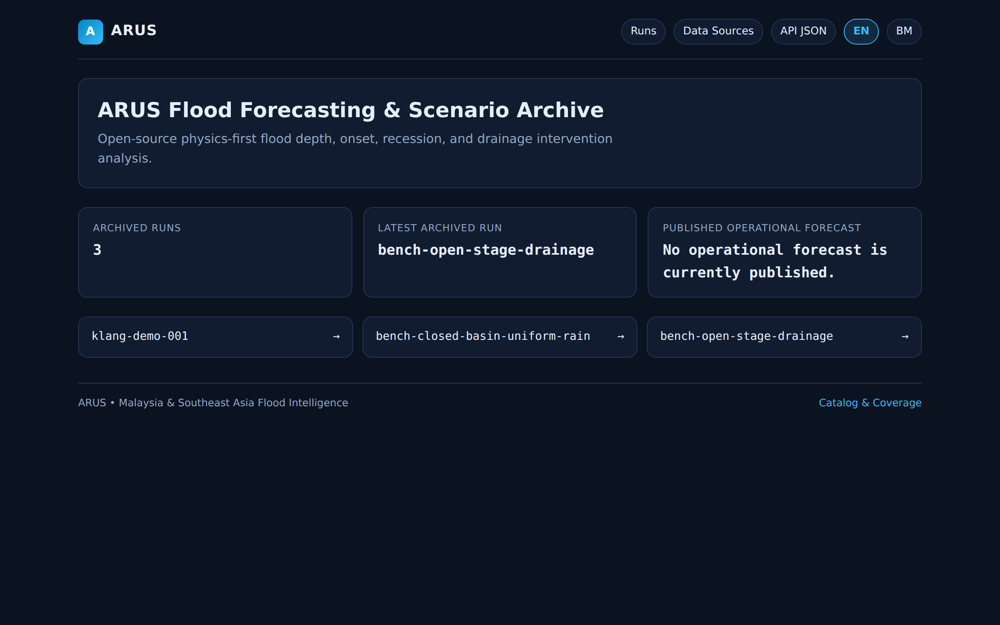
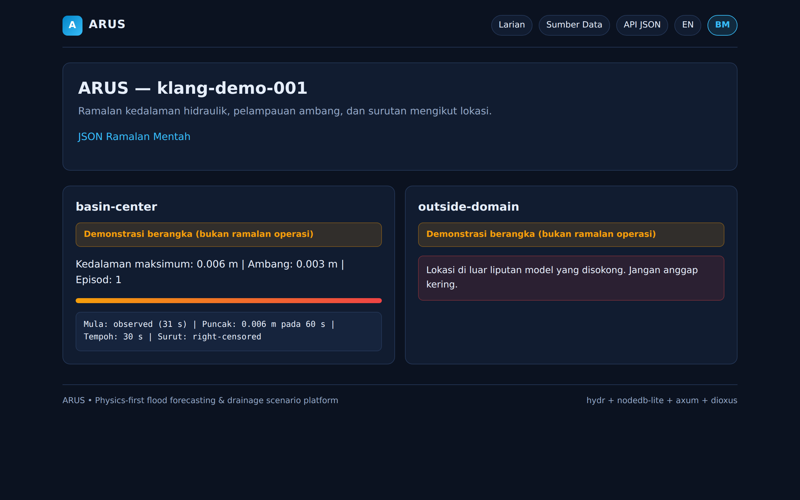
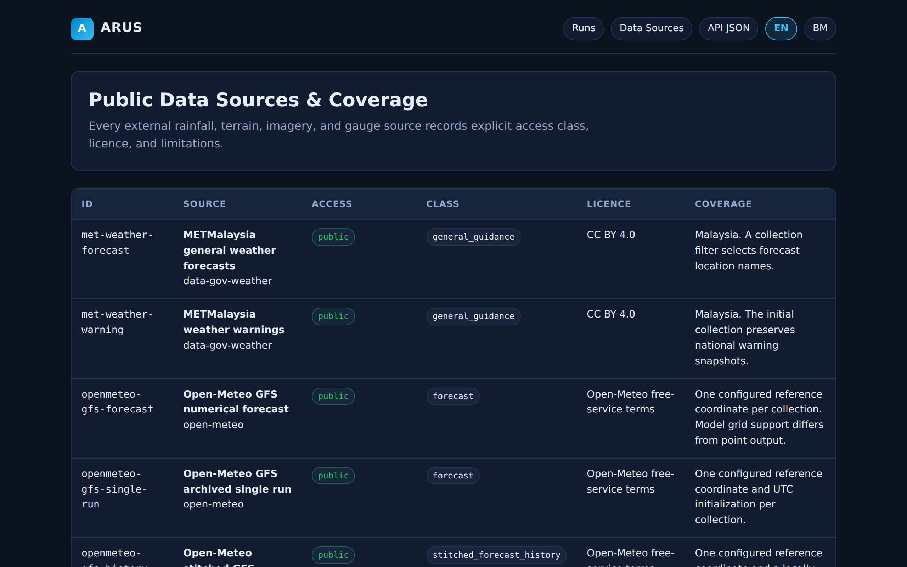

# ARUS

**Open-source, physics-first flood forecasting and drainage scenario platform for Malaysia and Southeast Asia.**



## What You Get

- **Location-specific flood outlooks**: Predicts water depth, onset time, peak depth, duration, and recession—not only coarse river-station warnings.
- **Drainage what-if testing**: Simulates detention ponds, sluice gates, pumps, HDS-5 culverts, 1D-2D rivers, and terrain edits side by side, explicitly flagging any downstream location made worse.
- **Built-in scientific honesty**: Every run displays its classification (`numerical-demonstration` vs `operational-forecast`), enforces water conservation, and marks uncovered locations explicitly instead of showing dry zero.
- **Native Bahasa Malaysia & English UI**: Switch between `EN` and `BM` on every page with zero external CDN dependencies.
- **Public data transparency**: Inspect every rainfall, terrain, imagery, and gauge source along with its access class, licence, and coverage limits.

## Screenshots

### Bilingual Location Outlook (Bahasa Malaysia)

Shows supported location depth vs threshold, episode onset/peak/recession timing, non-operational banners, and explicit out-of-coverage warnings.



### Data Sources & Coverage

Lists all registered Malaysian and global data sources with access gates, licences, and coverage limitations.



## Quick Start

Requires Rust `1.98.0` (pinned in `rust-toolchain.toml`).

```sh
# 1. Run a synthetic 2D shallow-water flood demonstration
cargo run -p arus-worker -- outlook --run-id demo-001 --archive data/runs

# 2. Launch the web dashboard and JSON API
cargo run -p arus-api -- --archive data/runs --bind 127.0.0.1:8080
```

Open `http://127.0.0.1:8080/?lang=en` (or `?lang=bm`) in your browser.

## What To Expect Today

- **Ready to run**: 2D shallow-water flow (`F64` reference and `F32` screening), 1D-2D river bank coupling, coupled detention pools (weirs, orifices, sluice gates, pumps, HDS-5 culverts), urban subcatchment runoff, paired scenario comparison, bitwise checkpoint resume, embedded `nodedb-lite` storage, JSON API, and the Dioxus web dashboard.
- **Not yet operational**: Live calibrated Malaysian flood forecasts require surveyed bare-earth LiDAR, local drainage geometry, official JPS/METMalaysia gauge and radar archives, and independent locked-event evaluation. Until approved, every run carries a visible non-operational banner.

## Documentation & Verification

- [Architecture & Workspace Boundaries](docs/architecture.md)
- [Public HTTP API (`arus-api-v1`)](docs/api/README.md)
- [Analytical & Coupled Benchmarks](benchmarks/manifests/README.md)
- [Data Acquisition Guide](docs/data-acquisition.md)

```sh
sh scripts/check.sh --offline
```
