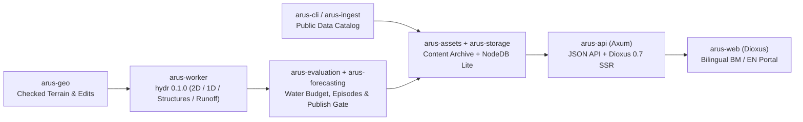

# ARUS

**Open-source, physics-first flood forecasting, monitoring, and drainage scenario platform in Rust.**

ARUS gives cities, river-basin engineers, and disaster-response teams a single, auditable open-source platform to:

- **Predict location-specific flooding**: depth, onset time, peak depth, duration, and recession (not only station alerts).
- **Test drainage interventions before building**: compare detention ponds, sluice gates, pumps, culverts, and terrain edits side by side—and explicitly surface any downstream location made worse.
- **Operate with verifiable scientific honesty**: every output carries provenance, mass-conservation residuals, explicit coverage boundaries (unsupported locations never render as dry zero), and strict publication gates.

Built in pure Rust (`#![forbid(unsafe_code)]`) on [`hydr`](https://crates.io/crates/hydr), [`nodedb-lite`](https://crates.io/crates/nodedb-lite), [`axum`](https://crates.io/crates/axum), and [`dioxus`](https://crates.io/crates/dioxus). Designed for Malaysia and Southeast Asia with native **Bahasa Malaysia / English** web views.

---

## Quick Start (30 Seconds)

Run a synthetic 2D shallow-water flood demonstration, persist its immutable run archive, and launch the bilingual Dioxus web portal:

```sh
# 1. Run a synthetic flood outlook and persist to data/runs
cargo run -p arus-worker -- outlook --run-id demo-001 --archive data/runs

# 2. Launch the Axum API + Dioxus SSR dashboard
cargo run -p arus-api -- --archive data/runs --bind 127.0.0.1:8080
```

Open in your browser:

- `http://127.0.0.1:8080/?lang=en` (or `?lang=bm`) — Run archive & publication dashboard
- `http://127.0.0.1:8080/runs/demo-001?lang=bm` — Bilingual location outlook cards
- `http://127.0.0.1:8080/sources?lang=en` — Public data catalog & coverage transparency table
- `http://127.0.0.1:8080/api/v1/runs` — JSON API (`arus-api-v1`)

---

## Capabilities

| Domain | What ARUS Runs Today | Entrypoint |
| --- | --- | --- |
| **2D Surface Hydraulics** | Full 2D shallow-water equations (CPU `F64` reference + opt-in `F32` screening), Modified Green-Ampt infiltration, 5 open-boundary types (`stage`, `discharge`, `exterior`, `transmissive`, `flux-port`), bitwise checkpoint resume | `arus-worker run`, `arus-worker surface-f32`, `arus-worker resume` |
| **1D-2D Coupled Rivers** | Conservative 2D floodplain + 1D rectangular channel coupling across bank weirs | `arus-worker coupled` |
| **Structures & Detention Pools** | Coupled level pools connected by weirs, submerged orifices, hydrostatic sluice gates, pumps, and HDS-5 circular/box culverts | `arus-worker pools` |
| **Urban Subcatchment Runoff** | Three-subarea impervious/pervious runoff with Modified Green-Ampt soil memory | `arus-worker runoff` |
| **Piped Drainage (SWMM)** | Manifest validation and isolated worker adapter for pinned EPA SWMM v5.2.4 (`EXTRAN` / `SLOT`) | `arus-worker drainage-check` |
| **Scenario & Mitigation Search** | Paired baseline vs intervention comparison with explicit `worsened_locations`, audited terrain conditioning, and Pareto mitigation screening | `arus-worker compare`, `crates/scenarios`, `crates/optimisation` |
| **Forecasting & Evaluation** | Deterministic flood-episode tracker (onset, peak, hysteresis, right-censored recession), monotonic publication gate, independent censored scoring, ML baseline gate | `arus-worker publish`, `crates/forecasting`, `crates/evaluation`, `crates/ml` |
| **Data Ingestion & Storage** | 17-source Malaysian/global data catalog with licence/rate gates, content-addressed archive, and embedded `nodedb-lite 0.1.0` store | `arus-cli catalog`, `arus-cli data`, `arus-cli runs`, `crates/storage` |
| **Public API & Web UI** | Axum HTTP API (`arus-api-v1`) and Dioxus 0.7 bilingual (BM/EN) SSR web portal | `apps/api`, `apps/web` |

---

## Architecture



| Workspace Path | Responsibility |
| --- | --- |
| `apps/api` | Axum public HTTP API and Dioxus SSR server |
| `apps/web` | Browser-safe Dioxus 0.7 bilingual (BM/EN) components (no solver, GIS, or DB deps) |
| `apps/worker` | Native numerical execution CLI (`run`, `coupled`, `pools`, `runoff`, `surface-f32`, `compare`, `resume`, `publish`) |
| `apps/cli` | Operator CLI for catalog checks, bounded data acquisition, and archived run inspection |
| `crates/hydraulics`, `crates/hydrology` | `hydr 0.1.0` numerical adapters (2D SWE, 1D channels, pools, structures, culverts, SWMM drainage, runoff) |
| `crates/forecasting`, `crates/evaluation` | Episode tracking, monotonic publication gate, independent censored scoring |
| `crates/scenarios`, `crates/optimisation`, `crates/ml` | Paired intervention comparison, Pareto mitigation screening, ML eligibility gate |
| `crates/geo`, `crates/ingest`, `crates/storage`, `crates/assets` | Checked terrain grids (ESRI ASCII), public data connectors, `nodedb-lite` store, immutable blob archive |
| `crates/domain`, `crates/api-types`, `crates/model-api`, `crates/jobs` | Shared domain provenance, browser-safe DTOs, backend contracts, cancellation & step budgets |
| `benchmarks/manifests` | 7 executable analytical and coupled verification manifests |

---

## Scientific Boundary & Roadmap

ARUS enforces an explicit boundary between **numerical verification** and **operational flood forecasting**:

- **Verified today**: All 7 analytical and coupled benchmark manifests ([benchmarks/manifests](benchmarks/manifests/README.md)) pass offline conservation, lake-at-rest, infiltration, open-stage drainage, runoff, and structure checks.
- **Not yet operational**: Producing calibrated Malaysian operational flood forecasts requires surveyed bare-earth LiDAR, local drainage geometry, official JPS/METMalaysia gauge/radar history, and independent locked-event hindcast evaluation. Until approved, every run displays an explicit `numerical-demonstration` banner.
- **Upcoming (`hydr 0.2.0` track)**: Subgrid terrain, higher-order/implicit time stepping, native Rust pressurized pipe networks, and 3-way simultaneous surface-channel-sewer coupling.

---

## Development & Verification

Requires Rust `1.98.0` (pinned in `rust-toolchain.toml`, minimum `1.96`).

```sh
# Format and run full offline verification (path hygiene, fmt, check, 88+ tests, strict clippy)
cargo fmt --all
sh scripts/check.sh --offline
```

See [docs/architecture.md](docs/architecture.md), [docs/api/README.md](docs/api/README.md), and [docs/data-acquisition.md](docs/data-acquisition.md) for detailed technical references.
